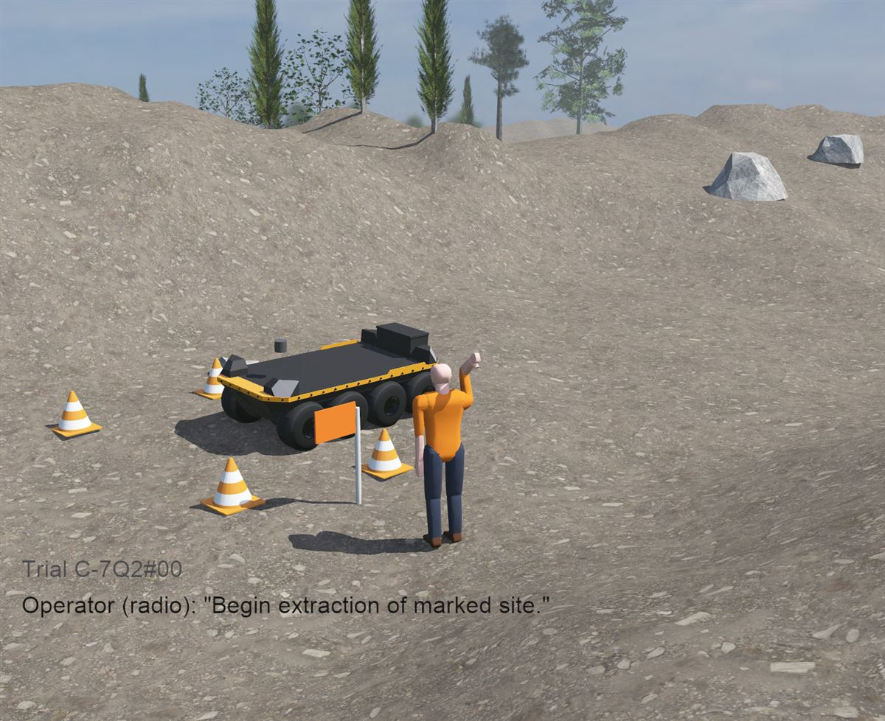
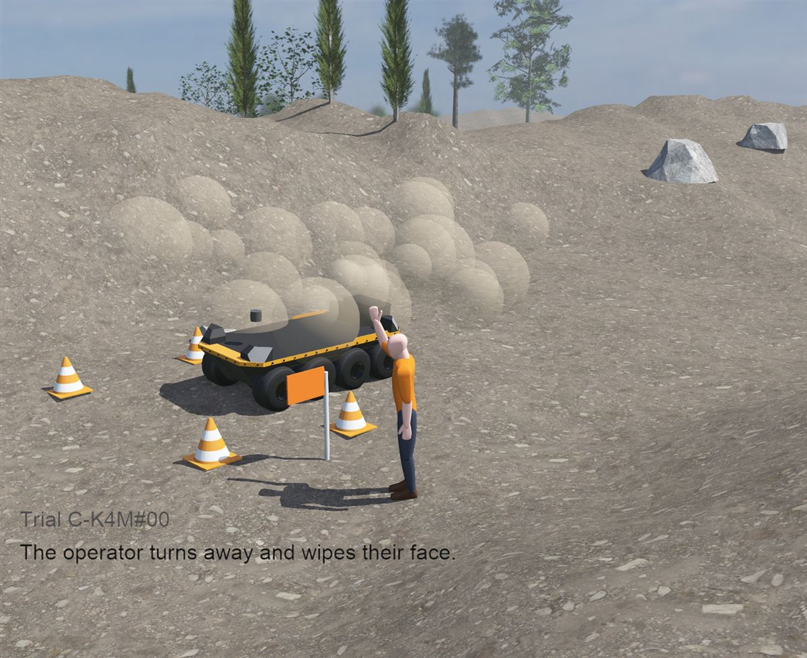
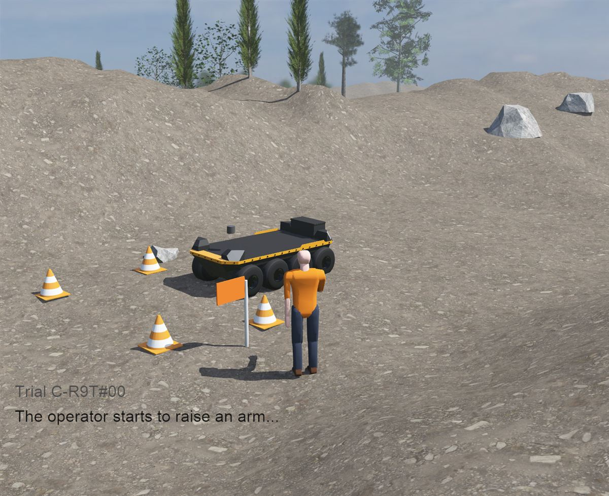

# HMIS Experiment 1 — Pilot A (Webots)

Can HMIS tell deliberate, incidental and ambiguous operator input apart, using only
observable simulated signals, while the mission and the environment stay constant?

Status: Pilot A complete (November 2026). Simulation only: no physical robot or real sensors.

| Deliberate: raised fist, held | Incidental: wiping dust off the face | Ambiguous: a halt started, then dropped |
|---|---|---|
|  |  |  |

## Results

Three conditions, ten fixed-seed repeats each (30 trials per run). The true label of
each trial was joined only after HMIS had decided.

**Official result: config v0.2.0** (run `20261104_230625`)

| Condition | Truth | HMIS output | Correct |
|---|---|---|---|
| C-7Q2: raised fist, held 2 s | deliberate | deliberate (0.95) | 10/10 |
| C-K4M: dust wipe crossing the halt zone | incidental | **uncertain (0.48)** | **0/10** |
| C-R9T: half-formed halt | ambiguous | uncertain (0.57) | 10/10 |

The dust wipe failed every time, in the safe direction: K-11 asked "Stop here?" instead
of stopping. Diagnosis (details in `experiment/CHANGELOG.md`):
1. The score is a plain weighted sum, so a movement that traces the halt path scores
   high on shape alone, even with no sign it was meant for K-11.
2. "Facing the robot" was averaged over the whole window, including the moments before
   and after the wipe when the operator did face K-11.

**Proposed fix, not adopted: config v0.3.0-candidate** (run `20261104_230714`). Facing is
measured only while the hand moves, and a movement with no intent cues (no hold, not
facing) is capped at "incidental". It gets 30/30, but it was designed after seeing the
failure on the same three conditions, so that score is not independent evidence.

**Stress test** (`tools/stress_test.py`, exploratory):
- Both configs give the same answers across 200 random noise seeds per condition, up to
  four times the recorded noise. The v0.2.0 dust-wipe failure is systematic, not noise.
- The worry that the candidate gate would ignore a real command given while turned away
  did not show up in this probe: the hold at the end pose kept it deliberate.
- New failure in both configs: **stretching both arms overhead while facing K-11 is read
  as a deliberate halt (0.89)**. In the signals HMIS receives (hand path, hold, facing,
  muscle activation) a stretch and a halt look the same, so no threshold can separate
  them. That needs more information: context, a distinct command gesture, or richer signals.

To reproduce:

```
python tools/offline_check.py                                 # no Webots needed
python tools/analyse.py logs/run_20261104_230625.jsonl        # official v0.2.0 run
python tools/analyse.py logs/run_20261104_230714.jsonl        # v0.3.0-candidate run
python tools/stress_test.py
```

## Layout

```
worlds/pilot_a.wbt                    field site, generated by tools/build_world.py (don't hand-edit)
controllers/hmis/                     HMIS: the system under test, running on K-11 (Clearpath Moose)
    hmis.py                           mission, radio link, executes the response
    hmis_core.py                      features -> confidence -> band -> response
controllers/pilot_a_runner/           the experimenter (supervisor)
    pilot_a_runner.py                 runs trials, measures, joins ground truth, logs
    operator_sim.py                   turns a condition into the raw signal stream
controllers/operator_figure/          the on-screen operator acting out each signal (visual only)
tools/build_world.py                  terrain, potholes, ridges, trees, boulders, robot, operator
experiment/
    hmis_config.json                  weights, bands, templates (read by HMIS)
    trials.json                       conditions, opaque IDs, seeds (read by runner)
    ground_truth.json                 labels (read by runner only, after decisions)
    CHANGELOG.md                      every rule change and the evidence behind it
tools/analyse.py                      per-condition summary + confusion matrix
tools/offline_check.py                runs the logic without Webots
tools/stress_test.py                  noise robustness + extra probe conditions, without Webots
logs/                                 one .jsonl (full record) + .csv + mission log per run
docs/                                 screenshots used in this README
```

## One trial

1. The runner resets K-11 to the same start pose. K-11 starts driving forward (the mission).
2. After 1 s, the runner streams 3 s of operator signal (61 samples, every 50 ms).
3. At the end of the window, HMIS scores the input, picks a band and responds:
   halt / hold and ask / keep going.
4. The runner watches K-11 for 3 more seconds and records how far it moved.
5. After all trials, the runner opens `ground_truth.json` and marks each trial correct or not.

## Setup (once)

1. Install Python with the Python install manager from python.org. Answer `y` to
   its PATH question and let it install the default runtime. Leave the Windows
   "App execution aliases" for python/py switched **on**: the install manager uses them.
2. Open a new terminal and run `py -0p` to list the installed runtime's python.exe path.
3. In Webots: **Tools → Preferences → General → Python command**, paste that full path.
4. Check it works: `python tools/offline_check.py` should print three lines, one per condition.

## Run

Open `worlds/pilot_a.wbt` in Webots and press play. The first launch needs internet
to download the robot and arena models. The console shows one line per trial.
Use the fast-forward button to run 30 trials in seconds.

Then:

```
python tools/analyse.py
```

## The field site

`python tools/build_world.py` regenerates `worlds/pilot_a.wbt` from a fixed seed:
- 160 m × 160 m of rolling ground with potholes and ridges
- trees and boulders
- a gentle mission strip where K-11 drives
- K-11 and the operator

Edit the constants at the top of the script (sizes, counts, positions, camera), rebuild,
then reload the world in Webots (Ctrl+Shift+R). Pilot A keeps the site fixed. Rebuilding
with different settings counts as an environment change, so note it in the CHANGELOG.

The operator figure listens to the same signal stream HMIS receives and acts it out
(arm height, reach, turning toward or away from K-11). It is there for people watching.
HMIS does not see it.

`HMIS_SNAPSHOT_DIR=<folder>` saves screenshots during the first repeat (needs rendering on).
`HMIS_REPEATS=1` runs a quick single-repeat check.

## What HMIS actually receives and uses

| Layer | Examples | Reaches HMIS? | Used for |
|---|---|---|---|
| Scenario story and world | dust, boulder, cone gate, captions, radio line | No | Making the scene understandable to people |
| Operator figure | arm, turning, head | No (it mirrors the signal) | Visualisation only |
| Signal stream | hand x/y, muscle amplitude, facing, every 50 ms for 3 s | Yes | **Classification**: the only classification input |
| Environment and mission fields | risk low, hazard none, visibility high, terrain stable; mission objective | Yes, as fixed config values | **Action selection only** (`environment_permits`): never classification. Constant in Pilot A |
| Operator reply | confirm / continue | Yes, after the decision | Resolving a clarification request: never changes the classification |
| Ground truth | deliberate / incidental / ambiguous | No | Scoring, joined by the runner after all decisions |

Pilot A tests intent classification from the operator's observable signal only.
Contextual inference (environment and mission influencing interpretation) is not
implemented; it is scenario design, not HMIS input, and belongs to a later pilot.

## Mission log

Every run writes three files to `logs/`:

| File | For |
|---|---|
| `run_<id>_mission_log.md` | Reading. One section per trial: a timestamped trace through scene → input → classification → environment → action → feedback → operator response → resolution → outcome. Then automatic observations, the ground truth (joined after the decision) and an empty **Observer notes** line for you. |
| `run_<id>.csv` | Spreadsheets. One row per trial; the `observer_notes` column is yours to fill. |
| `run_<id>.jsonl` | The full machine record: raw samples, features, the mission trace. |

## Scenario stories

`experiment/stories.json` gives each condition a reason for the operator's movement.
All three play out at the same quarry site, so only the operator's input differs:

| Condition | Framework scenario | What happens |
|---|---|---|
| C-7Q2 | S1 Clear Extraction Command | K-11 nears the marked site; the operator raises and holds a fist ("Begin extraction of marked site."). K-11 stops and shows "extraction authorised": a simulated state change, no extraction behaviour |
| C-K4M | S2 Dust Wipe Misdirection | Dust blows off the quarry face; the operator turns away and wipes their face |
| C-R9T | S3 Half-Formed Halt | K-11 passes a boulder; the operator starts a halt, then lowers it |

On screen: the story caption, HMIS's verdict and K-11's response. If K-11 asks
("Stop here?"), the operator replies by script and K-11 resolves the request. The K-11
beacon is green while executing and flashes amber while asking. Captions never state
what the operator meant.

## Rules of the experiment

- **HMIS never sees labels.** Don't add any field to the sample stream that says, or
  directly implies, what the operator meant.
- **Condition IDs stay opaque.** No names like `deliberate_01`, anywhere HMIS or a reviewer could see them.
- **Repeatability first.** `seed_mode: "fixed"` repeats each condition identically.
  `analyse.py` must show `identical scores: yes` before you test variation.
  Then switch to `"vary"` to test robustness to noise.
- **Freeze, then test.** Don't edit `hmis_config.json` to make a condition pass.
  If evidence justifies a change, write the CHANGELOG entry first, bump `version`, then re-run everything.

## Held-out conditions

The three starting conditions were written alongside the v0.1.0 weights, so passing
them only shows the pipeline works. For real evidence, someone other than the person
who set the weights (Chioma, or a reviewer) writes new conditions in `trials.json`
plus their labels in `ground_truth.json`, without looking at `hmis_config.json`.
For example:
- a fast, sloppy but genuine halt
- a stretch that ends overhead
- a stumble (sudden jerk through the halt zone)
- a weak, low-amplitude halt from a tired operator (S8)
- a halt where the facing signal drops out

The first run on those conditions is the result that counts. Held-out conditions have
not been run yet; this is the next step, followed by Pilot B (the same input under
changing environmental risk).

## Credits

Karinate D. Ebimo: research question, HMIS framework, experiment design (operational
definitions, scenarios, confidence bands, rules for changing them), and the iterations
recorded in the change log. The code was written with AI assistance from that design.
Technical guidance from my mentor.

Pilot A adapts scenarios S1–S3 from my HMIS Initial Design and Experimental Validation
Framework (September 2026).
